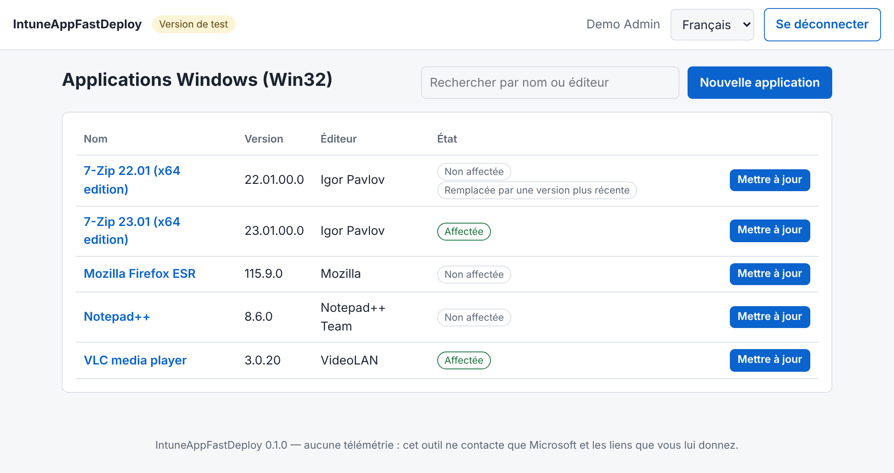
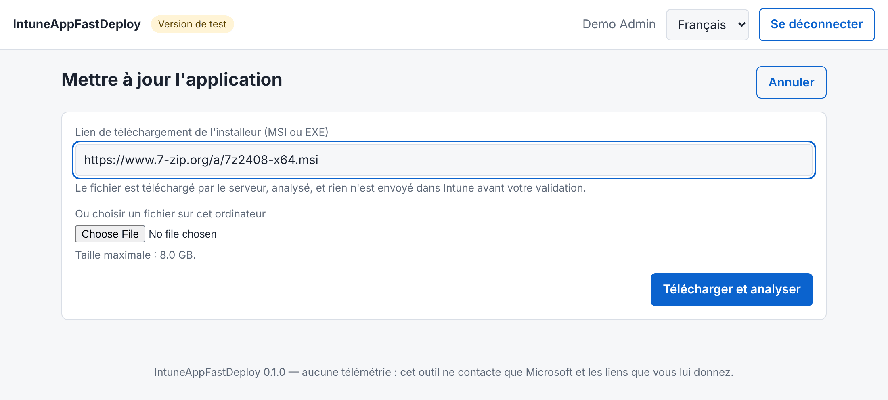
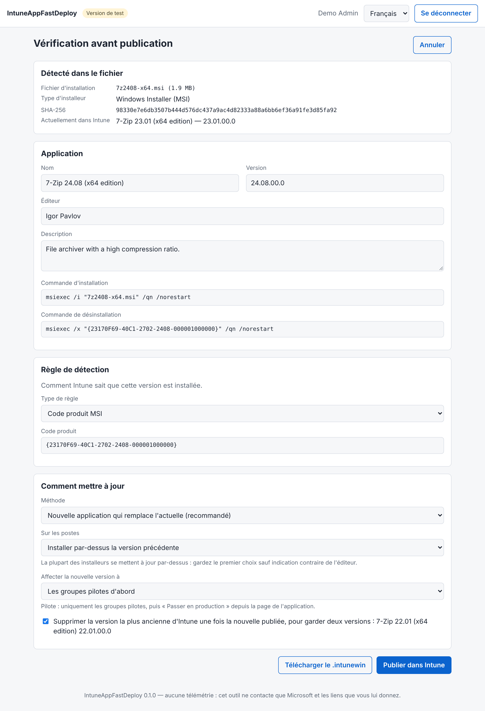
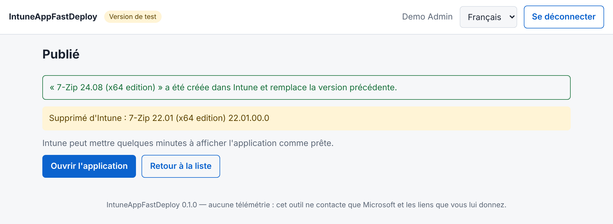
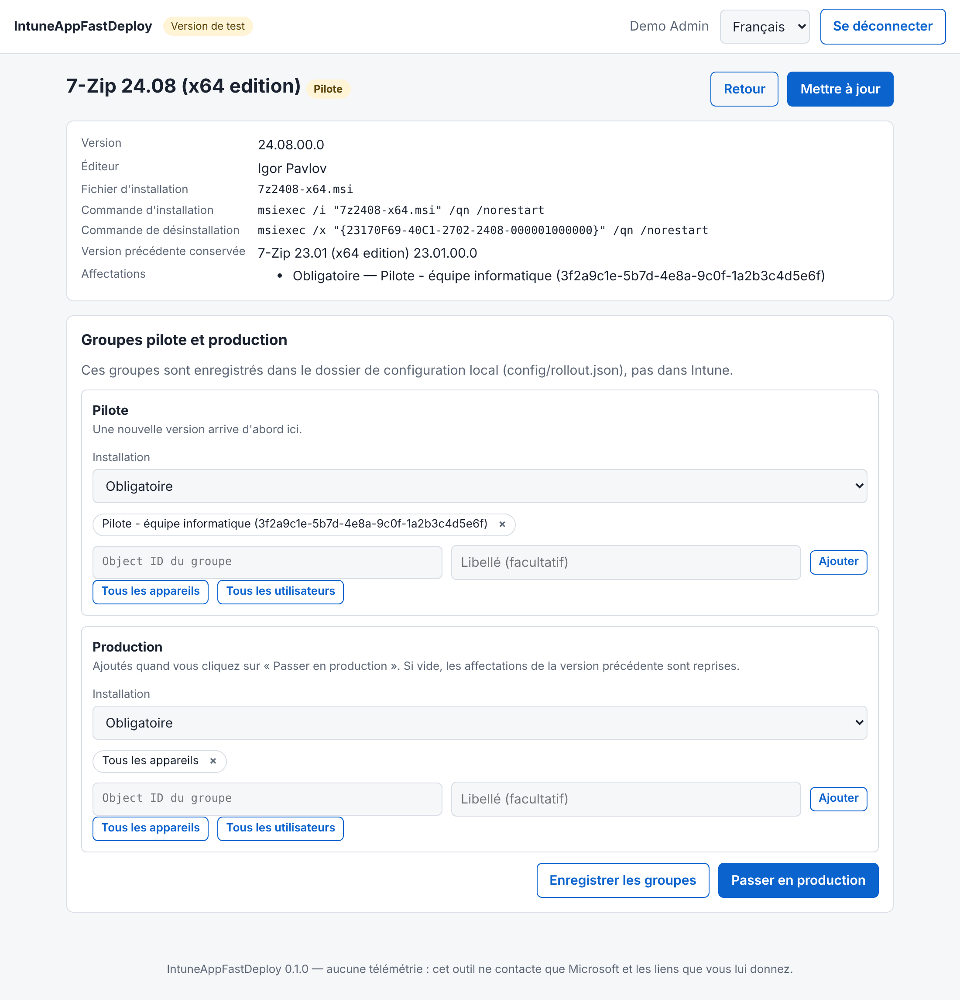
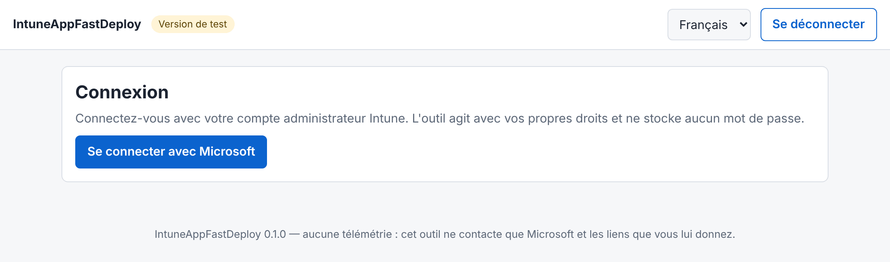
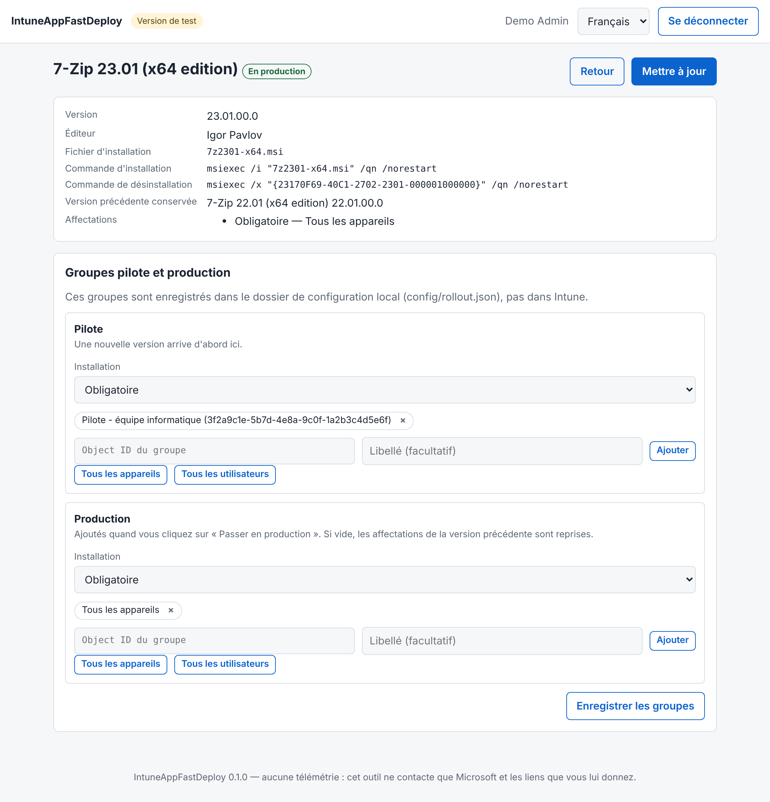
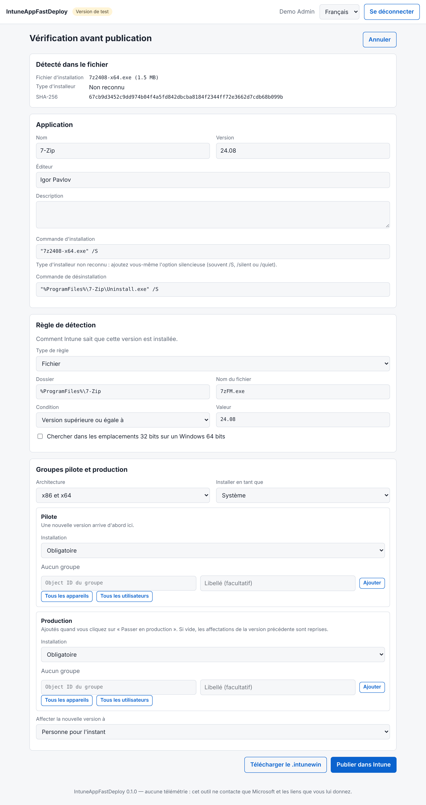

# IntuneAppFastDeploy

[English](README.md) · **Français**

Publier et mettre à jour des applications Windows (MSI / EXE) dans Microsoft Intune à partir d'un lien de téléchargement.

Vous collez le lien du nouvel installeur, l'outil le télécharge, lit ce qu'il peut dans le fichier, pré-remplit tout à partir de l'application déjà présente dans Intune, et vous cliquez sur **Publier**. Rien n'est envoyé dans Intune avant votre validation.

> ⚠️ **Version de test.** Cet outil n'a pas encore été validé sur un vrai tenant Intune : il est publié pour être testé, pas pour un usage en production. La création des paquets, les enchaînements et l'interface sont couverts par des tests automatiques, et les requêtes envoyées à Intune ont été vérifiées par rapport à la documentation de l'API Microsoft, mais les tests tournent face à un Intune simulé. Faites votre première publication sur une application sans importance et vérifiez le résultat dans le portail Intune. En cas d'échec, le bouton **Télécharger le .intunewin** vous donne un paquet à envoyer à la main, et un ticket avec le message affiché est le bienvenu.

## Sommaire

- [Aperçu](#aperçu)
- [Ce que fait l'outil](#ce-que-fait-loutil)
- [Ce qu'il vous faut](#ce-quil-vous-faut)
- [Étape 1 — Créer l'inscription d'application dans Microsoft Entra ID](#étape-1--créer-linscription-dapplication-dans-microsoft-entra-id)
- [Étape 2 — Installer sur votre PC](#étape-2--installer-sur-votre-pc)
- [Étape 3 — Utiliser](#étape-3--utiliser)
- [Groupes pilote et production](#groupes-pilote-et-production)
- [Sur un serveur, en HTTPS](#sur-un-serveur-en-https)
- [Qui peut se connecter](#qui-peut-se-connecter)
- [Garder l'outil à jour](#garder-loutil-à-jour)
- [Référence des réglages](#référence-des-réglages)
- [Confidentialité et sécurité](#confidentialité-et-sécurité)
- [Dépannage](#dépannage)
- [Limites](#limites)
- [Développement](#développement)
- [Ajouter une langue](#ajouter-une-langue)

## Aperçu

Ces écrans viennent de la démonstration intégrée, qui tourne face à un Intune simulé avec des applications d'exemple.

**La liste de vos applications Win32**, avec leur version et leur état. *Mettre à jour* part d'ici.



**1. Donnez le lien** du nouvel installeur, ou choisissez un fichier.



**2. Vérifiez avant de publier.** Le nom, la version, les commandes et la règle de détection sont pré-remplis à partir de l'application déjà présente dans Intune ; vous choisissez la méthode de mise à jour et qui reçoit la nouvelle version en premier.



**3. Publié.**



**Pilote, puis production.** La nouvelle version n'est affectée qu'aux groupes pilotes ; *Passer en production* ajoute les groupes de production.



<details>
<summary>Autres écrans : connexion, une application en production, une nouvelle application</summary>

**Connexion** avec votre propre compte administrateur Intune.



**Une application en production**, avec ses affectations et ses groupes pilote et production.



**Une nouvelle application** à partir d'un installeur EXE : vous renseignez une fois la commande de désinstallation et la règle de détection.



</details>

## Ce que fait l'outil

- **Mettre à jour une application** : collez le lien du nouvel installeur. La commande d'installation, la commande de désinstallation, la règle de détection, la description, l'icône et les prérequis sont repris de l'application actuelle ; seul ce qui change avec la version est modifié.
- **Deux méthodes de mise à jour**, au choix à chaque publication :
  - *Nouvelle application qui remplace l'actuelle* (supersédance, la méthode recommandée par Microsoft). Deux versions au plus sont conservées : quand une troisième est publiée, la plus ancienne est supprimée d'Intune, une fois la nouvelle publiée avec succès.
  - *Modifier l'application existante* : l'installeur est remplacé sur place ; les affectations ne changent pas.
- **Pilote, puis production** : une nouvelle version va d'abord aux groupes pilotes ; un bouton **Passer en production** ajoute les groupes de production.
- **Nouvelle application** : même écran, vous renseignez les champs une fois. Pour un MSI, tout est lu dans le fichier. Pour un EXE, l'outil reconnaît les installeurs courants (Inno Setup, NSIS, WiX Burn, InstallShield, Advanced Installer, Squirrel) et propose l'option silencieuse.
- **Crée le `.intunewin` sous Linux**, sans l'outil Microsoft réservé à Windows.
- **Fonctionne avec n'importe quel tenant** : rien de propre à un tenant n'est stocké dans ce dépôt ni dans l'image. Chaque organisation utilise sa propre inscription d'application.
- **Interface en français et en anglais**, un fichier par langue.

## Ce qu'il vous faut

- Une machine avec **Docker** (Docker Desktop sous Windows/macOS, Docker Engine avec Compose 2.24 ou plus récent sous Linux) et un accès Internet.
- Dans Microsoft Entra ID : le droit de créer une inscription d'application et d'**accorder le consentement administrateur** (Administrateur général, Administrateur de rôle privilégié ou Administrateur d'application cloud), une seule fois.
- Pour chaque personne qui utilise l'outil : un rôle Intune permettant de gérer les applications (**Administrateur Intune** ou **Gestionnaire d'applications**). L'outil agit avec les droits de la personne connectée et ne peut jamais faire plus qu'elle dans le portail Intune.

## Étape 1 — Créer l'inscription d'application dans Microsoft Entra ID

Cela déclare à Microsoft que l'outil existe dans *votre* tenant. Comptez cinq minutes, une seule fois.

1. Ouvrez <https://entra.microsoft.com> puis **Identité → Applications → Inscriptions d'applications → Nouvelle inscription**.
2. **Nom** : `IntuneAppFastDeploy` (le nom est libre).
3. **Types de comptes pris en charge** : *Comptes dans cet annuaire d'organisation uniquement (locataire unique)*.
4. **URI de redirection** : choisissez la plateforme **Client public/natif (mobile et bureau)** et saisissez :

   ```
   http://localhost:8080/auth/callback
   ```

5. Cliquez sur **Inscrire**.
6. Sur la page **Vue d'ensemble**, copiez les deux valeurs nécessaires à l'étape 2 :
   - **ID d'application (client)** → `CLIENT_ID`
   - **ID de l'annuaire (locataire)** → `TENANT_ID`
7. Allez dans **API autorisées → Ajouter une autorisation → Microsoft Graph → Autorisations déléguées**, cherchez `DeviceManagementApps.ReadWrite.All`, cochez-la et cliquez sur **Ajouter des autorisations**.
8. Cliquez sur **Accorder un consentement d'administrateur pour \<votre organisation\>** et confirmez. La colonne d'état doit afficher une coche verte.

Aucun secret client n'est nécessaire : l'inscription est un *client public* et chacun se connecte avec son propre compte.

**Facultatif — chercher les groupes par leur nom.** Par défaut, vous collez l'Object ID d'un groupe. Pour chercher les groupes par nom, ajoutez aussi l'autorisation déléguée `GroupMember.Read.All`, accordez à nouveau le consentement administrateur, et mettez `ENABLE_GROUP_PICKER: "true"` dans `docker-compose.yml`.

## Étape 2 — Installer sur votre PC

Un seul fichier suffit : `docker-compose.yml`. Il n'y a rien à cloner ni à construire.

1. Créez un dossier vide et téléchargez-y le fichier :

   ```bash
   curl -O https://raw.githubusercontent.com/jclayssen/IntuneAppFastDeploy/main/docker-compose.yml
   ```

   Sous Windows PowerShell :

   ```powershell
   Invoke-WebRequest -Uri https://raw.githubusercontent.com/jclayssen/IntuneAppFastDeploy/main/docker-compose.yml -OutFile docker-compose.yml
   ```

   Vous pouvez aussi ouvrir le fichier dans votre navigateur et l'enregistrer, ou copier son contenu.

2. Ouvrez `docker-compose.yml` dans un éditeur de texte et collez les deux valeurs de l'étape 1 entre les guillemets :

   ```yaml
   TENANT_ID: "00000000-0000-0000-0000-000000000000"
   CLIENT_ID: "11111111-1111-1111-1111-111111111111"
   ```

   Pour une interface en français par défaut, mettez aussi `DEFAULT_LANGUAGE: "fr"`.

3. **Sous Linux uniquement** : créez vous-même le dossier de configuration, pour qu'il vous appartienne et non à root :

   ```bash
   mkdir config
   ```

   Si votre utilisateur n'est pas le numéro 1000 (vérifiez avec `id -u`), changez aussi la ligne `user: "1000:1000"` dans `docker-compose.yml`.

4. Démarrez l'outil :

   ```bash
   docker compose up -d
   ```

5. Ouvrez <http://localhost:8080> et cliquez sur **Se connecter avec Microsoft**.

Le dossier `config` à côté de `docker-compose.yml` contient les groupes pilote/production (`config/rollout.json`). C'est un simple dossier sur votre disque, pas un volume Docker : sauvegardez-le comme n'importe quel fichier.

Après avoir changé un réglage dans `docker-compose.yml`, relancez `docker compose up -d`. Pour arrêter l'outil :

```bash
docker compose down
```

## Étape 3 — Utiliser

### Mettre à jour une application

1. Dans la liste, cliquez sur **Mettre à jour** sur la ligne de l'application.
2. Collez le lien de téléchargement du nouvel installeur (ou choisissez un fichier sur votre ordinateur) et cliquez sur **Télécharger et analyser**.
3. Relisez l'écran de vérification :
   - **Détecté dans le fichier** : nom du fichier, taille, type d'installeur et empreinte SHA-256. Comparez l'empreinte à celle publiée par l'éditeur quand il y en a une.
   - **Application** : nom, version, commandes. Le nom du fichier dans la commande d'installation est remplacé automatiquement.
   - **Règle de détection** : comment Intune sait que la nouvelle version est installée. Un code produit MSI ou une règle « version supérieure ou égale à » passe automatiquement à la nouvelle version. Lisez les notes en jaune quand il y en a.
   - **Comment mettre à jour** : la méthode, et qui reçoit la nouvelle version en premier.
4. Cliquez sur **Publier dans Intune**. L'avancement s'affiche étape par étape.

Le lien doit renvoyer l'installeur lui-même. Une page où il faut encore cliquer sur un bouton est refusée avec le message *« Le lien ne renvoie pas un fichier MSI ou EXE »* : copiez plutôt le lien du bouton de téléchargement final.

### Ajouter une nouvelle application

Cliquez sur **Nouvelle application**, donnez le lien, puis renseignez :

- **Commande d'installation** : proposée automatiquement pour les MSI et pour les installeurs EXE reconnus. Sinon, ajoutez l'option silencieuse indiquée par l'éditeur (souvent `/S`, `/silent` ou `/quiet`).
- **Commande de désinstallation** : automatique pour un MSI. Pour un EXE, elle ne peut pas être lue dans le fichier ; l'écran affiche la forme habituelle pour l'installeur reconnu.
- **Règle de détection** : pour un EXE, la règle fiable la plus simple est *Fichier*, avec le dossier et le nom du programme principal, et *Version supérieure ou égale à*.
- **Groupes pilote et production**, et qui reçoit l'application maintenant.

### Les deux méthodes de mise à jour

| | Nouvelle application qui remplace l'actuelle | Modifier l'application existante |
|---|---|---|
| Ce qui se passe dans Intune | Une nouvelle application est créée, avec une supersédance vers l'actuelle | L'installeur de la même application est remplacé |
| Retour arrière | La version précédente est toujours là | Impossible |
| Phase pilote | Oui | Non |
| Anciennes versions | Deux conservées ; la plus ancienne est supprimée à la troisième | Rien à nettoyer |

La suppression de la version la plus ancienne est annoncée sur l'écran de vérification, avec une case à décocher pour la conserver. Elle n'a lieu qu'après la publication réussie de la nouvelle version, et elle est irréversible.

## Groupes pilote et production

Ouvrez une application (cliquez sur son nom) pour configurer, application par application :

- **Pilote** : les groupes qui reçoivent une nouvelle version en premier.
- **Production** : les groupes ajoutés quand vous cliquez sur **Passer en production**. Si vous laissez vide, les affectations de la version précédente sont reprises.

Pour chacun, vous choisissez *Obligatoire* ou *Disponible*, et vous ajoutez des groupes :

- **Tous les appareils** / **Tous les utilisateurs** : un clic.
- **Un groupe** : collez son **Object ID**. Vous le trouvez dans le centre d'administration Entra, sous **Groupes → \<le groupe\> → Vue d'ensemble → ID d'objet**. Le libellé n'est qu'un aide-mémoire pour vous.
- Avec `ENABLE_GROUP_PICKER: "true"` (voir étape 1), une zone de recherche trouve les groupes par leur nom.

Au moment de publier une nouvelle version, vous choisissez *Les groupes pilotes d'abord*, *La production directement* ou *Personne pour l'instant*. Pendant la phase pilote, la page de l'application affiche le badge **Pilote** et le bouton **Passer en production**.

Ces réglages suivent l'application d'une version à la suivante. Ils sont stockés uniquement dans `config/rollout.json` — rien n'est écrit dans le champ Notes ni ailleurs dans Intune.

## Sur un serveur, en HTTPS

En dehors de `localhost`, la connexion Microsoft exige HTTPS. Le profil `https` démarre un petit serveur web (Caddy) devant l'outil.

1. Dans `docker-compose.yml`, renseignez l'adresse dans le service `app`, puis le nom et le certificat dans le service `https` :

   ```yaml
   PUBLIC_URL: "https://intune-deploy.exemple.fr"
   ```

   ```yaml
   SITE_ADDRESS: "intune-deploy.exemple.fr"
   TLS: "internal"
   ```

   `TLS` choisit le certificat :

   | `TLS:` | Certificat | Conditions |
   |---|---|---|
   | `"internal"` | Autosigné, généré automatiquement | Aucune. Les navigateurs affichent un avertissement tant que le certificat n'est pas approuvé (voir plus bas). |
   | `"/certs/cert.pem /certs/key.pem"` | Votre propre certificat | Placez le certificat (avec sa chaîne) et la clé privée dans un dossier `certs` à côté de `docker-compose.yml`, sous ces noms. |
   | `"vous@exemple.fr"` | Let's Encrypt, renouvelé automatiquement | `SITE_ADDRESS` doit être un nom DNS public pointant vers le serveur, et les ports 80 et 443 doivent être joignables depuis Internet. |

2. Dans l'inscription d'application Entra (**Authentification → Applications mobiles et de bureau → Ajouter un URI**), ajoutez :

   ```
   https://intune-deploy.exemple.fr/auth/callback
   ```

3. Démarrez avec le profil :

   ```bash
   docker compose --profile https up -d
   ```

4. Ouvrez `https://intune-deploy.exemple.fr`.

**Approuver le certificat autosigné.** Avec `TLS: "internal"`, le certificat de l'autorité est écrit dans `config/caddy/caddy/pki/authorities/local/root.crt`. Importez-le sur les PC des collègues comme *Autorité de certification racine de confiance* (vous pouvez le déployer avec Intune) et l'avertissement disparaît.

**N'exposez pas l'outil sur Internet sans nécessité.** Il permet aux administrateurs connectés de pousser un logiciel sur tous les postes. Let's Encrypt impose que le serveur soit joignable depuis Internet ; sur un réseau interne, préférez votre propre certificat ou l'autosigné.

Aucun autre fichier n'est nécessaire : la configuration du frontal HTTPS est contenue dans `docker-compose.yml`.

## Qui peut se connecter

Seuls les comptes de votre tenant peuvent se connecter, et Intune applique les droits de chacun. Pour restreindre davantage, au choix :

- renseignez `ALLOWED_USERS: "premier@exemple.fr,second@exemple.fr"` dans `docker-compose.yml`, ou
- dans le centre d'administration Entra, ouvrez **Applications d'entreprise → IntuneAppFastDeploy → Propriétés**, passez **Affectation requise ?** à **Oui**, puis ajoutez les personnes autorisées dans **Utilisateurs et groupes**.

Les sessions vivent dans la mémoire du conteneur : le redémarrer déconnecte tout le monde.

## Garder l'outil à jour

Sur la machine qui fait tourner l'outil, une seule commande récupère la dernière image et redémarre :

```bash
docker compose pull && docker compose up -d
```

Vous pouvez la planifier (Planificateur de tâches Windows, cron) si vous voulez qu'elle se fasse sans vous.

Comment les nouvelles images sont produites, pour la personne qui maintient le dépôt (ou un fork) :

- Les dépendances sont déclarées en versions minimales dans `pyproject.toml`. Les versions exactes qui ont passé les tests sont notées dans `uv.lock`, un fichier généré que personne n'édite à la main.
- **[Renovate](https://github.com/apps/renovate)** (un robot gratuit, installé sur le dépôt en un clic) ouvre une demande de fusion quand une dépendance, l'image de base ou une GitHub Action a une nouvelle version, et une autre chaque semaine pour rafraîchir `uv.lock`. Une dépendance touchée par une faille connue reçoit une demande immédiatement, étiquetée `security`. **Renovate ne fusionne jamais** : quelqu'un relit la demande, constate que les tests sont verts, et la fusionne.
- Chaque fusion dans `main` publie une nouvelle image. L'image est aussi reconstruite chaque lundi, pour que le système de base reçoive ses correctifs de sécurité même quand rien d'autre n'a changé.
- **CodeQL** analyse le code de l'outil lui-même à chaque modification.

Pour les demandes de sécurité de Renovate, activez **Settings → Code security → Dependabot alerts** sur le dépôt.

Ce qui demande encore une personne : fusionner les demandes, regarder celle dont les tests échouent, et lancer la commande de mise à jour sur le serveur.

## Référence des réglages

Tous les réglages vont dans la section `environment:` du service `app` de `docker-compose.yml`. Relancez `docker compose up -d` après un changement.

| Réglage | Défaut | Signification |
|---|---|---|
| `TENANT_ID` | — | ID de l'annuaire (locataire). Obligatoire. |
| `CLIENT_ID` | — | ID d'application (client). Obligatoire. |
| `PUBLIC_URL` | `http://localhost:8080` | Adresse saisie dans le navigateur. L'URI de redirection est `PUBLIC_URL` + `/auth/callback`. |
| `DEFAULT_LANGUAGE` | `en` | Langue utilisée quand celle du navigateur n'est pas disponible. Mettez `fr` pour le français. |
| `ENABLE_GROUP_PICKER` | `false` | Chercher les groupes par nom (demande `GroupMember.Read.All`). |
| `ALLOWED_USERS` | vide | Identifiants de connexion autorisés, séparés par des virgules. Vide : tout le tenant. |
| `MAX_DOWNLOAD_MB` | `8192` | Taille maximale d'un installeur. |
| `SESSION_HOURS` | `12` | Heures avant de devoir se reconnecter. |
| `CLIENT_SECRET` | vide | Uniquement pour une inscription de type *Web* avec secret. |
| `AUTHORITY_HOST` / `GRAPH_URL` | cloud public Microsoft | Pour les clouds nationaux. Non testé. |

En dehors de `environment:`, trois autres lignes de `docker-compose.yml` peuvent être adaptées : `user:` (propriétaire du dossier `config` sous Linux), `ports:` (port local ; si vous le changez, changez aussi `PUBLIC_URL` et l'URI de redirection), et `SITE_ADDRESS` / `TLS` dans le service `https`.

## Confidentialité et sécurité

- **Aucune télémétrie.** L'outil ne contacte que Microsoft (connexion, Microsoft Graph, le stockage Azure désigné par Intune pour l'envoi) et les liens de téléchargement que vous lui donnez.
- **Rien de votre tenant ne quitte votre machine ni n'est stocké dans ce dépôt.** Vos identifiants sont dans votre propre copie de `docker-compose.yml`, et vos groupes dans votre dossier `config`.
- **Aucun mot de passe ni secret n'est stocké.** La connexion utilise le flux par code d'autorisation avec PKCE ; les jetons restent en mémoire.
- **Droits délégués uniquement.** Chaque action est faite au nom de la personne connectée et apparaît à son nom dans les journaux d'audit Intune.
- **Les installeurs sont téléchargés par le serveur.** Toute personne qui peut se connecter peut faire télécharger une URL au serveur, y compris interne : réservez l'accès aux administrateurs.
- Le conteneur tourne avec un utilisateur non privilégié, toutes les capacités Linux retirées.

Pour signaler un problème de sécurité, voyez la [politique de sécurité](SECURITY.md#politique-de-sécurité) : utilisez la page **Security → Report a vulnerability** du dépôt plutôt qu'un ticket public.

## Dépannage

| Message ou symptôme | Cause et solution |
|---|---|
| *Configuration nécessaire* au démarrage | `TENANT_ID` ou `CLIENT_ID` est vide dans `docker-compose.yml`. Renseignez-les et relancez `docker compose up -d`. |
| `AADSTS50011` (URI de redirection incorrect) | L'adresse du navigateur et `PUBLIC_URL` doivent correspondre exactement à un URI de redirection de l'inscription, `http`/`https` et port compris. |
| `AADSTS7000218` (secret client requis) | L'URI de redirection a été ajouté sous la plateforme *Web*. Déplacez-le dans **Applications mobiles et de bureau**, ou renseignez `CLIENT_SECRET`. |
| `AADSTS65001` (consentement requis) | Le consentement administrateur n'a pas été accordé (étape 1, point 8). |
| *La connexion Microsoft est injoignable* | `TENANT_ID` erroné, ou le conteneur n'a pas accès à Internet. |
| *Votre compte n'a pas les droits pour cette action dans Intune* | La personne connectée a besoin du rôle Administrateur Intune ou Gestionnaire d'applications. |
| *Le lien ne renvoie pas un fichier MSI ou EXE* | Le lien mène à une page web ou demande une connexion. Téléchargez le fichier vous-même et utilisez **choisir un fichier**. |
| *Intune a refusé la requête* | Le détail après le tiret est le message d'Intune. Utilisez **Télécharger le .intunewin** pour envoyer à la main, et ouvrez un ticket avec ce détail. |
| *Le dossier config n'est pas accessible en écriture* (bandeau rouge, Linux) | Docker a créé le dossier en tant que root. Donnez-le à l'utilisateur de la ligne `user:` : `sudo chown -R 1000:1000 config`. |
| `docker compose up` n'arrive pas à télécharger l'image | Vérifiez l'accès Internet de la machine et que `ghcr.io` n'est pas bloqué par un proxy ou un pare-feu. |
| L'application reste « non prête » dans Intune | Intune traite le paquet pendant quelques minutes après l'envoi. |

Journaux :

```bash
docker compose logs -f app
```

## Limites

- Applications Windows Win32 uniquement (pas le Microsoft Store, macOS ni les mobiles).
- Un seul fichier d'installation par application. Un installeur qui a besoin de plusieurs fichiers à côté de lui doit d'abord être regroupé en un seul EXE ou MSI.
- La commande de désinstallation et la règle de détection d'un EXE ne se devinent pas à partir du fichier : vous les saisissez une fois, puis elles sont reprises à chaque mise à jour.
- Les règles de détection par script sont recopiées telles quelles.
- La version la plus ancienne est supprimée d'Intune quand une troisième est publiée (sauf si vous décochez la case).

## Développement

Prérequis : [uv](https://docs.astral.sh/uv/).

```bash
uv sync
```

```bash
uv run pytest
```

```bash
uv run ruff check . && uv run ruff format .
```

Construire et lancer l'image à partir de votre copie du code plutôt que l'image publiée :

```bash
docker compose -f docker-compose.yml -f docker-compose.dev.yml up -d --build
```

Lancer l'interface face à un Intune simulé, sans connexion (développement uniquement) :

```bash
uv run python -m tests.demo
```

Organisation :

| Chemin | Rôle |
|---|---|
| `src/iafd/download.py`, `msi.py`, `exe.py`, `analyze.py` | Récupérer un installeur et lire ses informations |
| `src/iafd/intunewin.py` | Créer (et déballer) les paquets `.intunewin` |
| `src/iafd/appmodel.py` | Construire les données envoyées à Microsoft Graph (fonctions pures) |
| `src/iafd/graph.py`, `publish.py` | Appels Microsoft Graph et enchaînements de publication |
| `src/iafd/auth.py`, `web.py`, `jobs.py`, `store.py` | Connexion, API HTTP, tâches de fond, configuration locale |
| `src/iafd/static/`, `src/iafd/locales/` | Interface et ses textes |

Régénérer les captures d'écran du README après un changement d'interface (demande Node.js et Playwright ; relancez la démonstration avant chaque langue pour repartir des mêmes données) :

```bash
node docs/screenshots/make.js en
```

```bash
node docs/screenshots/make.js fr
```

### Référence Microsoft Graph

L'outil utilise le point d'accès bêta de Microsoft Graph. Pages par rapport auxquelles le code a été vérifié : [win32LobApp](https://learn.microsoft.com/en-us/graph/api/resources/intune-apps-win32lobapp?view=graph-rest-beta), [win32LobAppFileSystemRule](https://learn.microsoft.com/en-us/graph/api/resources/intune-apps-win32lobappfilesystemrule?view=graph-rest-beta), [win32LobAppRegistryRule](https://learn.microsoft.com/en-us/graph/api/resources/intune-apps-win32lobappregistryrule?view=graph-rest-beta), [win32LobAppProductCodeRule](https://learn.microsoft.com/en-us/graph/api/resources/intune-apps-win32lobappproductcoderule?view=graph-rest-beta), [mobileAppContentFile](https://learn.microsoft.com/en-us/graph/api/resources/intune-apps-mobileappcontentfile?view=graph-rest-beta), [commit](https://learn.microsoft.com/en-us/graph/api/intune-apps-mobileappcontentfile-commit?view=graph-rest-beta), [renewUpload](https://learn.microsoft.com/en-us/graph/api/intune-apps-mobileappcontentfile-renewupload?view=graph-rest-beta), [assign](https://learn.microsoft.com/en-us/graph/api/intune-apps-mobileapp-assign?view=graph-rest-beta), [win32LobAppAssignmentSettings](https://learn.microsoft.com/en-us/graph/api/resources/intune-apps-win32lobappassignmentsettings?view=graph-rest-beta), [mobileAppSupersedence](https://learn.microsoft.com/en-us/graph/api/resources/intune-apps-mobileappsupersedence?view=graph-rest-beta), [updateRelationships](https://learn.microsoft.com/en-us/graph/api/intune-apps-mobileapp-updaterelationships?view=graph-rest-beta).

## Ajouter une langue

1. Copiez `src/iafd/locales/en.json` vers `src/iafd/locales/<code>.json` (par exemple `de.json`).
2. Traduisez les valeurs. Gardez les clés et les `{variables}` inchangées, et mettez dans `_name` le nom de la langue tel qu'il doit apparaître dans le menu.
3. Lancez `uv run pytest` : un test vérifie qu'aucun texte ne manque.

La langue apparaît automatiquement dans le menu.

## Licence

[MIT](LICENSE)
