# IntuneAppFastDeploy

**English** · [Français](README.fr.md)

Publish and update Windows applications (MSI / EXE) in Microsoft Intune from a download link.

You paste the link of the new installer, the tool downloads it, reads what it can from the file, pre-fills everything from the application that already exists in Intune, and you click **Publish**. Nothing is sent to Intune before you confirm.

> ⚠️ **Test version.** This tool has not yet been validated against a real Intune tenant: it is published for testing, not for production use. The packaging, the workflows and the interface are covered by automated tests, and the requests sent to Intune were checked against Microsoft's API documentation, but the tests run against a simulated Intune. Do your first publication on an unimportant application and check the result in the Intune portal. If something fails, the **Download the .intunewin** button gives you a package you can upload by hand, and an issue with the message shown is welcome.

## Contents

- [A quick look](#a-quick-look)
- [What it does](#what-it-does)
- [What you need](#what-you-need)
- [Step 1 — Create the app registration in Microsoft Entra ID](#step-1--create-the-app-registration-in-microsoft-entra-id)
- [Step 2 — Install on your PC](#step-2--install-on-your-pc)
- [Step 3 — Use it](#step-3--use-it)
- [Pilot and production groups](#pilot-and-production-groups)
- [Device inventory](#device-inventory)
- [Removing software from the devices](#removing-software-from-the-devices)
- [Replacing an older version](#replacing-an-older-version)
- [Running on a server with HTTPS](#running-on-a-server-with-https)
- [Who can sign in](#who-can-sign-in)
- [Keeping the tool up to date](#keeping-the-tool-up-to-date)
- [Settings reference](#settings-reference)
- [Privacy and security](#privacy-and-security)
- [Troubleshooting](#troubleshooting)
- [Limits](#limits)
- [Development](#development)
- [Adding a language](#adding-a-language)

## A quick look

These screens come from the built-in demo, which runs against a simulated Intune with sample applications.

**The list of your Win32 applications**, with their version and status. *Update* starts from here.

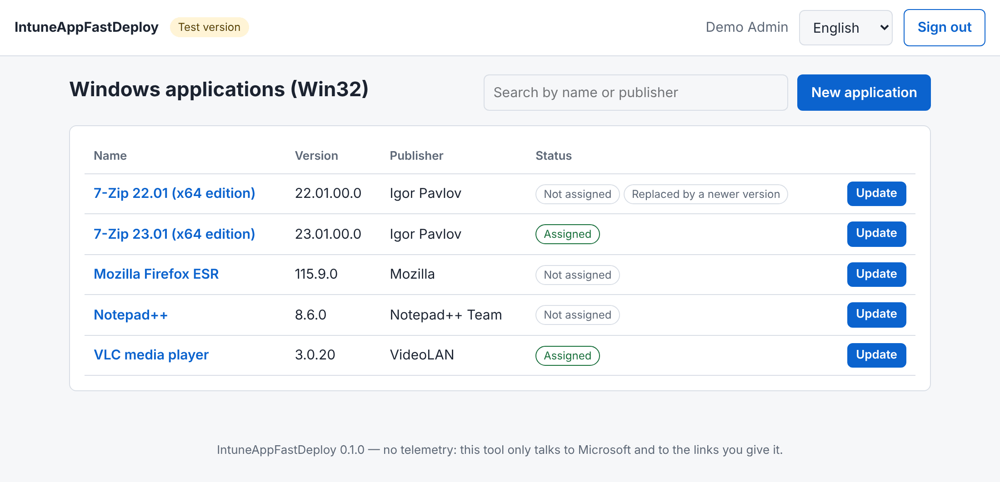

**1. Give the link** of the new installer, or choose a file.

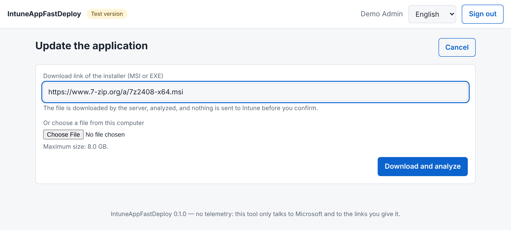

**2. Check before publishing.** Name, version, commands and detection rule are pre-filled from the application that is already in Intune; you choose the update method and who gets the new version first.

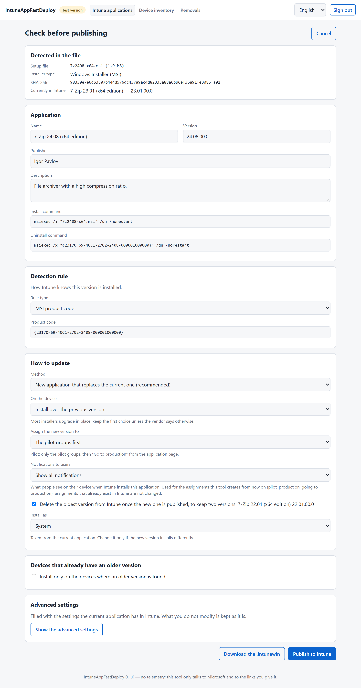

**3. Published.**

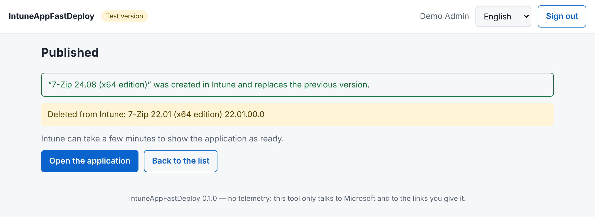

**Pilot, then production.** The new version is assigned to the pilot groups only; *Go to production* adds the production groups.

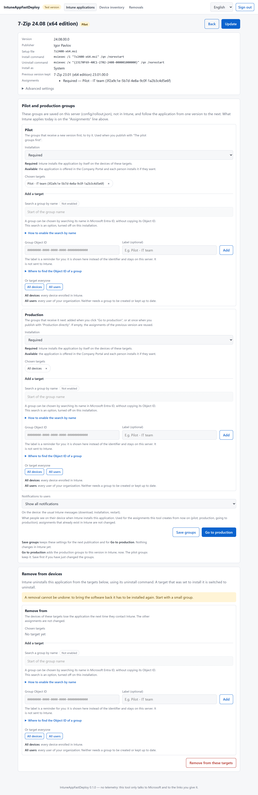

**Device inventory** (optional): the software Intune found on the devices, whether or not Intune installed it.

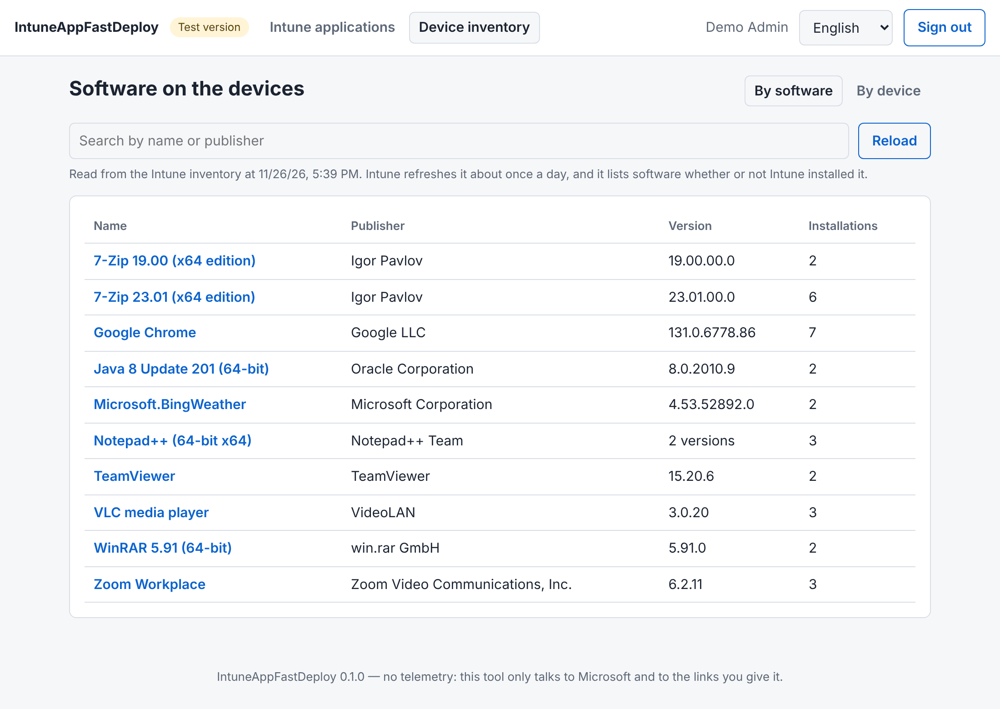

<details>
<summary>More screens: sign-in, an application in production, a new application</summary>

**Sign-in** with your own Intune administrator account.

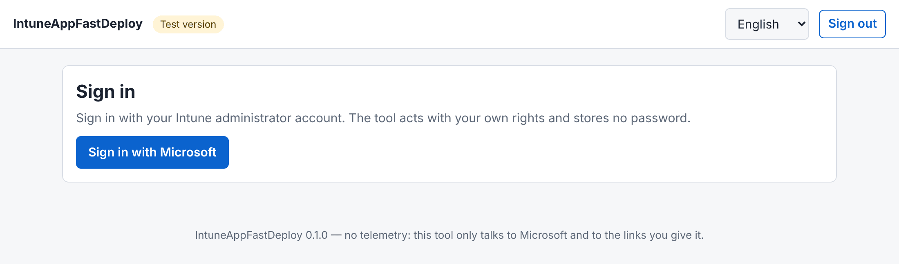

**An application in production**, with its assignments and its pilot and production groups.

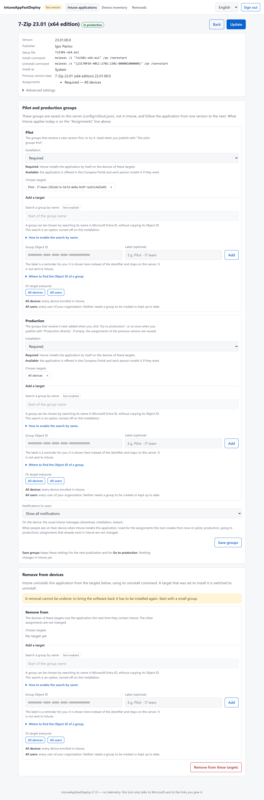

**A new application** from an EXE installer: you fill in the uninstall command and the detection rule once.

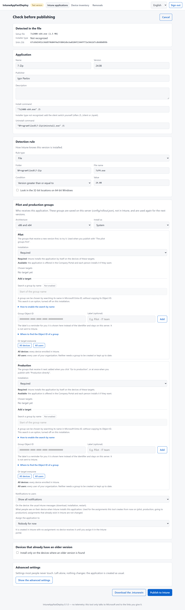

**Advanced settings**, closed by default at the bottom of the review screen: device requirements, restart, installation time.

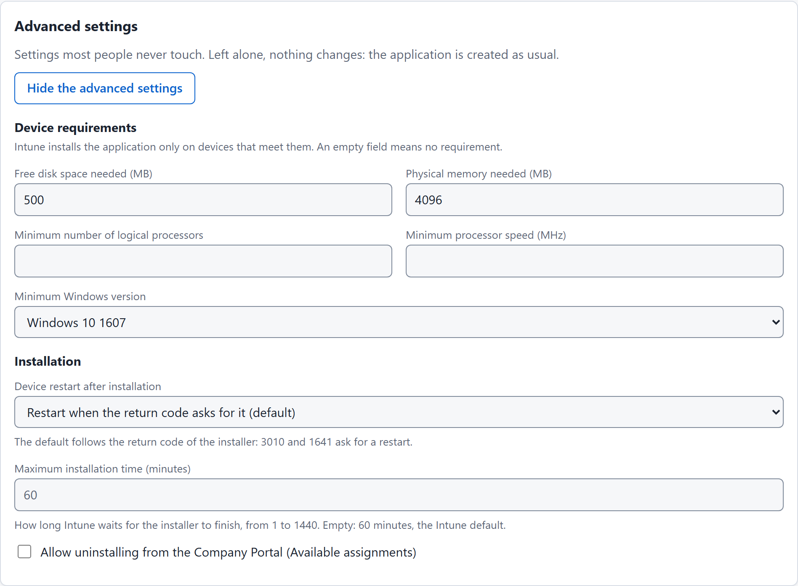

**Removing software**: the rule form, with the number of installations concerned and a typed confirmation.

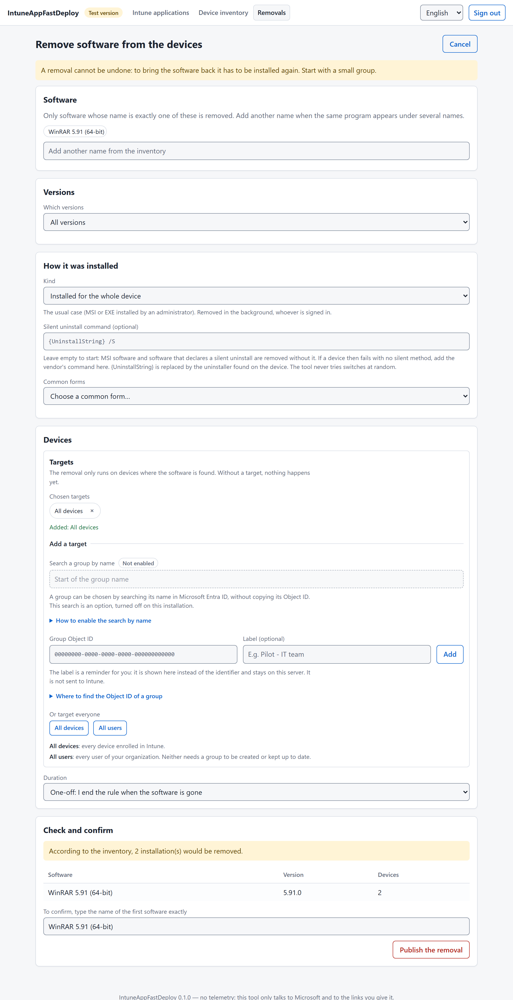

**The result on each device.** Here the program has no silent uninstall: the devices report a failure until a command is added to the rule.

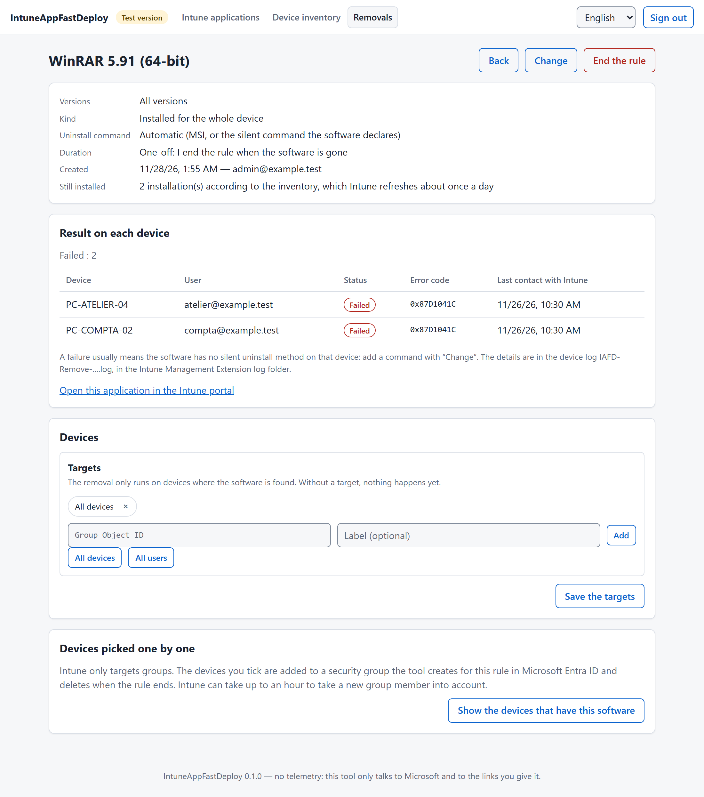

**One device** and the software found on it.

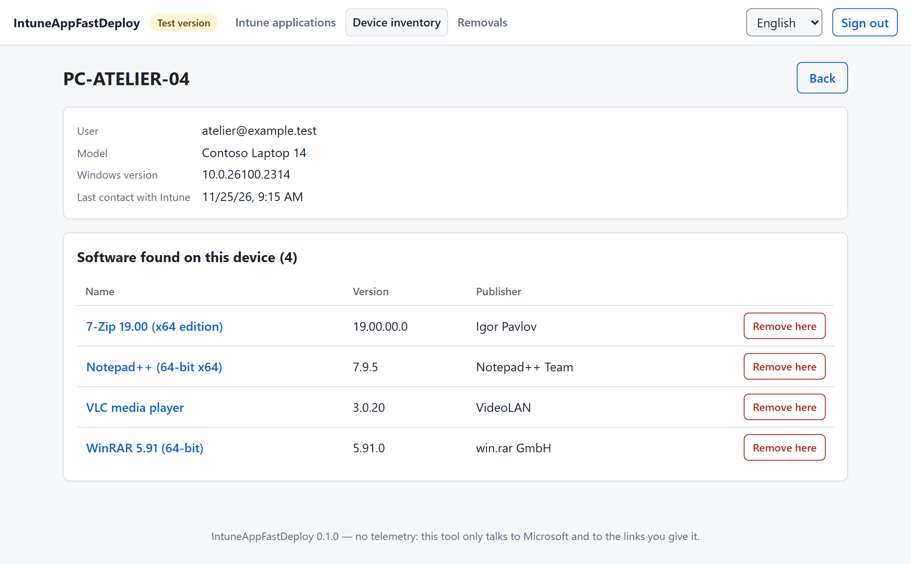

</details>

## What it does

- **Update an application**: paste the link of the new installer. Install command, uninstall command, detection rule, description, icon and requirements are copied from the current application; only what changes with the version is updated.
- **Two update methods**, chosen at each publication:
  - *New application that replaces the current one* (supersedence, Microsoft's recommended method). At most two versions are kept: when a third one is published, the oldest is deleted from Intune after the new one has been published successfully.
  - *Modify the existing application*: the installer is replaced in place; assignments do not change.
- **Pilot, then production**: a new version goes to the pilot groups first; a **Go to production** button adds the production groups.
- **New application**: same screen, you fill in the fields once. For an MSI everything is read from the file. For an EXE the tool recognizes common installers (Inno Setup, NSIS, WiX Burn, InstallShield, Advanced Installer, Squirrel) and proposes the silent switch.
- **Creates the `.intunewin` on Linux**, without Microsoft's Windows-only tool.
- **Works with any tenant**: nothing about a tenant is stored in this repository or in the image. Each organization uses its own app registration.
- **Device inventory** (optional, read-only): the software found on your Windows devices, by software or by device, including what was not installed through Intune.
- **Software removal** (optional): remove a program from the devices through Intune, including one Intune did not install, with the result on each device.
- **Replacing older versions** (optional): publish a new version only for the devices that have an older one, removing the old one first when its installer cannot upgrade over it.
- **English and French interface**, one file per language.

## What you need

- A machine with **Docker** (Docker Desktop on Windows/macOS, Docker Engine with Compose 2.24 or later on Linux) and Internet access.
- In Microsoft Entra ID: the right to create an app registration and to **grant admin consent** (Global Administrator, Privileged Role Administrator or Cloud Application Administrator), once.
- For each person who uses the tool: an Intune role that can manage apps (**Intune Administrator** or **Application Manager**). The tool acts with the rights of the signed-in person and can never do more than they can do in the Intune portal.

## Step 1 — Create the app registration in Microsoft Entra ID

This tells Microsoft that the tool exists in *your* tenant. It takes about five minutes and is done once.

1. Open <https://entra.microsoft.com> and go to **Identity → Applications → App registrations → New registration**.
2. **Name**: `IntuneAppFastDeploy` (any name works).
3. **Supported account types**: *Accounts in this organizational directory only (single tenant)*.
4. **Redirect URI**: choose the platform **Public client/native (mobile & desktop)** and enter:

   ```
   http://localhost:8080/auth/callback
   ```

5. Click **Register**.
6. On the **Overview** page, copy the two values you will need in step 2:
   - **Application (client) ID** → `CLIENT_ID`
   - **Directory (tenant) ID** → `TENANT_ID`
7. Go to **API permissions → Add a permission → Microsoft Graph → Delegated permissions**, search for `DeviceManagementApps.ReadWrite.All`, tick it and click **Add permissions**.
8. Click **Grant admin consent for \<your organization\>** and confirm. The status column must show a green tick.

No client secret is needed: the registration is a *public client* and each person signs in with their own account.

**Optional — search groups by name.** By default you paste the Object ID of a group. The tool can also search your groups by name. Wherever a group is chosen, the interface says that this search exists and shows the same steps under **How to enable the search by name**. Follow them in this order: a permission that has not been consented makes sign-in fail.

1. In the app registration: **API permissions → Add a permission → Microsoft Graph → Delegated permissions**, search for `GroupMember.Read.All`, tick it and click **Add permissions**.
2. Click **Grant admin consent for \<your organization\>** again. The status column must show a green tick next to `GroupMember.Read.All`.
3. Only then, set `ENABLE_GROUP_PICKER: "true"` in `docker-compose.yml` (step 2) and run `docker compose up -d`. Everyone signs in again.

To go back, set it to `"false"` again and run `docker compose up -d`. `GroupMember.Read.All` is read-only (groups and their members) and the tool only uses it for this search.

## Step 2 — Install on your PC

One file is enough: `docker-compose.yml`. There is nothing to clone or build.

1. Create an empty folder and download the file into it:

   ```bash
   curl -O https://raw.githubusercontent.com/jclayssen/IntuneAppFastDeploy/main/docker-compose.yml
   ```

   On Windows PowerShell:

   ```powershell
   Invoke-WebRequest -Uri https://raw.githubusercontent.com/jclayssen/IntuneAppFastDeploy/main/docker-compose.yml -OutFile docker-compose.yml
   ```

   You can also open the file in your browser and save it, or copy its content.

2. Open `docker-compose.yml` in a text editor and paste the two values from step 1 between the quotes:

   ```yaml
   TENANT_ID: "00000000-0000-0000-0000-000000000000"
   CLIENT_ID: "11111111-1111-1111-1111-111111111111"
   ```

3. **Linux only**: create the configuration folder yourself, so that it belongs to you and not to root:

   ```bash
   mkdir config
   ```

   If your user is not number 1000 (check with `id -u`), also change the line `user: "1000:1000"` in `docker-compose.yml`.

4. Start the tool:

   ```bash
   docker compose up -d
   ```

5. Open <http://localhost:8080> and click **Sign in with Microsoft**.

The `config` folder next to `docker-compose.yml` holds the pilot/production groups (`config/rollout.json`). It is a plain folder on your disk, not a Docker volume: back it up like any other file.

After changing a setting in `docker-compose.yml`, run `docker compose up -d` again. To stop the tool:

```bash
docker compose down
```

## Step 3 — Use it

### Update an application

1. In the list, click **Update** on the application.
2. Paste the download link of the new installer (or choose a file from your computer) and click **Download and analyze**.
3. Check the review screen:
   - **Detected in the file**: file name, size, installer type and SHA-256 fingerprint. Compare the fingerprint with the one published by the vendor when there is one.
   - **Application**: name, version, commands. The setup file name inside the install command is replaced automatically.
   - **Detection rule**: how Intune knows the new version is installed. An MSI product code or a "version greater than or equal to" rule is moved to the new version automatically. Read the yellow notes when there are any.
   - **How to update**: the method, who receives the new version first, the notifications people see, and **Install as** (System or User), taken from the current application.
   - **Advanced settings**: closed by default, filled with the settings of the current application. See [Advanced settings](#advanced-settings).
4. Click **Publish to Intune**. The progress is shown step by step.

The link must return the installer itself. A page where you still have to click a button is refused with the message *"The link does not return an MSI or EXE file"*: copy the link of the final download button instead.

### Add a new application

Click **New application**, give the link, then fill in:

- **Install command**: proposed automatically for MSI files and for recognized EXE installers. Otherwise add the silent switch given by the vendor (often `/S`, `/silent` or `/quiet`).
- **Uninstall command**: automatic for an MSI. For an EXE it cannot be read from the file; the screen shows the usual form for the recognized installer.
- **Detection rule**: for an EXE, the simplest reliable rule is *File*, with the folder and name of the main program and *Version greater than or equal to*.
- **Architecture** and **Install as**: *System* (the usual choice: the installer runs with the rights of the device) or *User* (it runs in the session of the signed-in person, for software that installs per user). A per-user MSI is proposed as *User*, everything else as *System*.
- **Pilot and production groups**, the notifications people see, and who receives the application now.
- **Advanced settings**, if you need them: device requirements, restart, installation time. See [Advanced settings](#advanced-settings).

### The two update methods

| | New application that replaces the current one | Modify the existing application |
|---|---|---|
| What happens in Intune | A new application is created with a supersedence link to the current one | The installer of the same application is replaced |
| Going back | The previous version is still there | Not possible |
| Pilot phase | Yes | No |
| Old versions | Two kept; the oldest is deleted when a third is published | Nothing to clean up |

Deleting the oldest version is announced on the review screen, with a checkbox to keep it. It happens only after the new version has been published successfully, and it cannot be undone.

### System or user installation

**Install as** is the *install behavior* of the Intune portal (`installExperience.runAsAccount` in Microsoft Graph). The application page shows it, and so does the review screen of an update, filled with the value of the current application:

- Left as it is, nothing changes: the new application is a copy of the current one, and an in-place update does not send this setting at all.
- Changed with *New application that replaces the current one*: the new application is created with the new value; the previous version keeps its own.
- Changed with *Modify the existing application*: the tool asks Intune to change it on the application itself. This request has not been tried on a real tenant, and the Intune portal does not always allow this change on an existing application: if Intune refuses, the error is shown and you can publish again with the first method.

### Advanced settings

At the bottom of the review screen, **Show the advanced settings** opens a section most people never need. It is there when adding an application and for both update methods.

| Setting | In Intune (Microsoft Graph) | Left alone on a new application |
|---|---|---|
| Free disk space needed (MB) | `minimumFreeDiskSpaceInMB` | No requirement |
| Physical memory needed (MB) | `minimumMemoryInMB` | No requirement |
| Minimum number of logical processors | `minimumNumberOfProcessors` | No requirement |
| Minimum processor speed (MHz) | `minimumCpuSpeedInMHz` | No requirement |
| Minimum Windows version | `minimumSupportedWindowsRelease` | Windows 10 1607 |
| Device restart after installation | `installExperience.deviceRestartBehavior` | Restart when the return code asks for it |
| Maximum installation time (minutes) | `installExperience.maxRunTimeInMinutes` | 60 minutes, the Intune default |
| Allow uninstalling from the Company Portal | `allowAvailableUninstall` | No |

- **New application**: an empty field keeps the default above. Whoever does not open the section gets exactly the application the tool created before this section existed.
- **Update**: the section is filled with what the current application has in Intune, whether it was set with this tool or in the portal. What you do not modify is kept: the copy made by *New application that replaces the current one* carries the same values, and *Modify the existing application* does not send these settings at all. Only what you change is sent.
- Emptying a requirement removes it. Emptying the installation time goes back to 60 minutes.
- The Windows versions offered go from Windows 10 1607 to Windows 11 23H2. A more recent one set in the Intune portal is kept as it is, and can only be chosen there.
- The values are checked on the server: whole numbers greater than zero, an installation time of at most 1440 minutes, known choices only.
- The application page lists these settings under **Advanced settings**.

Left to the Intune portal, because each needs a screen of its own: requirement rules based on a script, a file or the registry (the existing ones are copied at each update), dependencies (kept by an update), return codes, the architecture of an existing application, the restart grace period, the installation deadline and the delivery optimization priority of an assignment, the logo, the category, and the other fields of the application information.

## Pilot and production groups

Open an application (click its name) to configure, per application:

- **Pilot**: the groups that receive a new version first, to try it. Used when you publish with *The pilot groups first*.
- **Production**: the groups that receive it next: added when you click **Go to production**, or at once when you publish with *Production directly*. If you leave it empty, the assignments of the previous version are reused.

For each one you choose how Intune installs the application:

- *Required*: Intune installs it by itself on the devices of the targets.
- *Available*: it is offered in the Company Portal and each person installs it if they want.

Then you add targets:

- **All devices** / **All users**: one click. Every device enrolled in Intune, or every user of your organization, with no group to create or keep up to date.
- **A group**: paste its **Object ID**. You find it in the Entra admin center under **Groups → All groups → \<the group\> → Overview → Object ID**. The label is only a reminder for you: it is shown instead of the identifier, stays in `config/rollout.json` and is not sent to Intune.
- **Search a group by name**: with `ENABLE_GROUP_PICKER: "true"` (see [step 1](#step-1--create-the-app-registration-in-microsoft-entra-id)), a search box finds the groups of Microsoft Entra ID by the start of their name, 20 at most. While the option is off, the same place says that the search exists and unfolds the steps to enable it, so nobody has to leave the tool to find out.

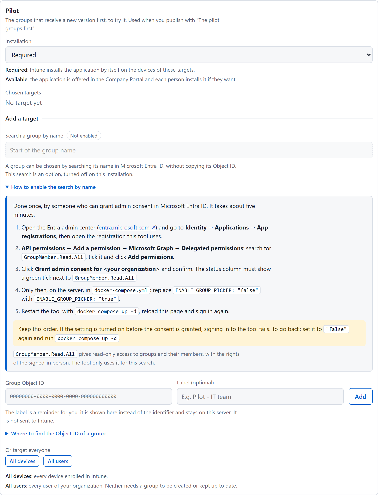

Every part of these screens carries a short explanation of what it does. **Save groups** only records the settings on the server: nothing changes in Intune until the next publication or **Go to production**. What Intune applies today is on the **Assignments** line of the application page.

When you publish a new version you choose who receives it:

| Choice | Who receives the new version |
|---|---|
| *The pilot groups first* | Only the pilot groups. **Go to production**, on the application page, then adds the production groups. |
| *Production directly* | The production groups, and the pilot groups if there are any, as soon as it is published. With no production group configured, the assignments of the previous version are reused. |
| *Nobody for now* | Nobody: the application is created in Intune with no assignment, until you assign it in the Intune portal. |

During the pilot phase the application page shows the **Pilot** badge and the **Go to production** button.

### Notifications to users

**Notifications to users**, under the groups, is what people see on their device when Intune installs the application. It is the *End user notifications* setting of an assignment in the Intune portal:

| Choice | On the device |
|---|---|
| Show all notifications (default) | The usual Intune messages: download, installation, restart |
| Show only restart notifications | Nothing, except when a restart is needed |
| Hide all notifications | Nothing |

The tool uses it for every assignment it creates: the pilot groups, the production groups, and the ones added by **Go to production**. You can set it on the application page (saved with **Save groups**), when adding an application, and when publishing a new version with the first method.

- Assignments that already exist in Intune are not changed when you save the setting: it applies from the next assignment the tool creates. To change an assignment that is already there, use the Intune portal.
- When no production group is configured, the assignments of the previous version are copied as they are, with the notifications they have in Intune.
- The application page tells it next to an assignment when it is not *Show all notifications*.

These settings follow the application from one version to the next. They are stored in `config/rollout.json` only — nothing is written in the Notes field or anywhere else in Intune.

## Device inventory

This optional section shows the software Intune has found on your Windows devices — everything that appears in *Apps → Monitor → Discovered apps* in the Intune portal, whether or not it was installed through Intune.

- **By software**: each program with its publisher, the versions seen and the number of installations; open one to see which devices have which version.
- **By device**: each Windows device with its user, model and last contact with Intune; open one to see everything found on it.

It is read-only: nothing is changed on the devices or in Intune.

### Enabling it

1. In the Entra app registration (**API permissions → Add a permission → Microsoft Graph → Delegated permissions**), add `DeviceManagementManagedDevices.Read.All`, then click **Grant admin consent** again.
2. In `docker-compose.yml`, set:

   ```yaml
   ENABLE_DEVICE_INVENTORY: "true"
   ```

3. Run `docker compose up -d`, then sign out and sign in again so the new permission is taken into account.

Do the first step before the second: if the option is on while the permission has not been granted, sign-in fails with `AADSTS65001`.

### What to know

- Intune refreshes this inventory about once a day for Windows software, and only on devices that run the Intune Management Extension. A program installed this morning may not be listed yet.
- Intune reports the name, version and publisher only. It does not say how a program was installed.
- Personal devices are not inventoried by Intune.
- The tool keeps what it read for five minutes; **Reload** reads it again.
- The same program can appear under several names when its name contains the version (for example *7-Zip 19.00* and *7-Zip 23.01*).

## Removing software from the devices

From the device inventory you can remove a program from the devices, including one that Intune did not install. It needs the [device inventory](#device-inventory) option and no other permission.

### How it works

Intune has no "uninstall this program" button for software it did not deploy. The tool uses the mechanism Intune does have: it creates a small Intune application, named *Removal - \<program\>*, whose content is a script and whose only job is to uninstall. It is assigned with the **Uninstall** intent, so Intune runs it only on the devices where the program is detected, then checks that it is gone.

On each device the script looks for the program by its **exact name** and removes it silently:

| Program | What happens |
|---|---|
| Installed from an MSI | Removed with its product code. Reliable. |
| Declares a silent uninstall command | That command is used. |
| Neither | The device reports a failure and nothing is run. You then add the vendor's silent command to the rule. |
| Microsoft Store app | Removed for every user of the device. |

The tool never tries switches at random. Some old programs have no silent uninstall at all: those cannot be removed automatically, by this tool or any other.

### Creating a removal

1. Open **Device inventory**, open the program, click **Remove this software**.
2. Check the form:
   - **Software**: the exact names. Add another name from the inventory when the same program appears under several names (often because the name contains the version).
   - **Versions**: all, the ones you tick, or everything older than a version.
   - **Kind**: installed for the whole device, in a user's profile, or a Store app. A program installed in a user's profile is removed in that user's session, so only while they are signed in.
   - **Command**: leave empty to start. `{UninstallString}` stands for the uninstaller found on the device, for example `{UninstallString} /S`.
   - **Targets**: groups, all devices or all users. Start with a small group.
   - **Duration**: *one-off* (you end the rule when the program is gone) or *permanent* (it is removed again if it comes back).
3. The form shows how many installations the inventory knows about. Type the name of the first program to confirm, then **Publish the removal**.

### Following and ending a removal

The **Removals** section lists the rules. A rule shows the result on each device — removed, waiting for the device, or failed with Intune's error code — and how many installations the inventory still reports. From there you can change the targets, change the rule (for instance to add a command after a failure), or **End the rule**: its Intune application is deleted and no device is targeted any more.

A device only acts when it next checks in with Intune, and the inventory is refreshed about once a day: allow that long before concluding.

On a device, the script writes `IAFD-Remove-<program>.log` in the Intune Management Extension log folder (`C:\ProgramData\Microsoft\IntuneManagementExtension\Logs`), which the portal's *Collect diagnostics* action retrieves.

### On one device, on demand

For an isolated case you can remove a program from a single device without creating a rule for a group. Open the device in **Device inventory → By device** and click **Remove here** next to the program.

This uses another Intune mechanism, a *remediation* run on demand: the tool creates a remediation script that is never assigned, and asks Intune to run it on that device only. The device runs it at its next check-in, and the rule page then shows what the device answered. The same settings started on another device reuse the same script. Ending the rule deletes the script.

It is a separate option because it needs more:

1. In the Intune portal, **Devices → Scripts and remediations**: remediations must have been enabled once, which includes confirming the Windows licence (Windows Enterprise E3 or E5, included in Microsoft 365 E3, E5 and F3). Devices must be Microsoft Entra joined or hybrid joined.
2. In the Entra app registration, add the delegated permissions `DeviceManagementScripts.ReadWrite.All` and `DeviceManagementManagedDevices.PrivilegedOperations.All`, then **Grant admin consent** again.
3. In `docker-compose.yml`, set `ENABLE_REMEDIATIONS: "true"` (with `ENABLE_DEVICE_INVENTORY: "true"`), then run `docker compose up -d` and sign in again.

The second permission lets the signed-in administrator start privileged actions on devices. Leave the option off if you only need removals by group.

### Picking devices one by one

A removal by group can also be aimed at devices you tick. On the page of a rule, **Devices picked one by one** lists the devices that have the software according to the inventory; tick some and click **Remove from the ticked devices**.

Intune only targets groups, so the tool creates one security group per rule in Microsoft Entra ID, named *IntuneAppFastDeploy removal - \<program\>*, adds the ticked devices to it and assigns the removal to it. The group is deleted when the rule ends. Intune can take up to an hour to take a new member into account.

It is a separate option because of what it needs: in the Entra app registration, add the delegated permissions `Group.ReadWrite.All` and `Device.Read.All`, grant admin consent again, then set `ENABLE_DEVICE_GROUPS: "true"` (with `ENABLE_DEVICE_INVENTORY: "true"`) in `docker-compose.yml`. `Group.ReadWrite.All` lets the signed-in administrator change any group of the tenant: leave the option off if targeting existing groups is enough, or use [removal on one device](#on-one-device-on-demand) for isolated cases.

### Guardrails

- **Protected software**: the tool refuses to remove what would break device management, security or Windows (the Intune agent, Company Portal, Defender, Edge WebView2, Microsoft 365 Apps, Visual C++ and .NET runtimes, hardware drivers…). Add your own entries in `config/protected.txt`, one per line: an exact name, or `re:` followed by a regular expression.
- **Exact names only**: no wildcard, so a neighbouring program is never removed by mistake.
- **Typed confirmation**, with the number of installations concerned.

These checks are made by the server, not only by the interface.

### Removing an application Intune installed

On the page of an Intune application, **Remove from devices** assigns that application with the Uninstall intent to the targets you choose; Intune then uses the application's own uninstall command. **Stop removing** withdraws it: no device is targeted any more, and the application is not put back where it was removed.

### What to know

- **A removal cannot be undone.** To get the program back it has to be installed again.
- Removal rules are stored in `config/removals.json`. Nothing is written in the Notes of your applications.
- The script was tested on Windows with real installers, but not yet through a real Intune tenant: make your first removal on unimportant software and one or two devices.

## Replacing an older version

When a program is already on some devices — whether or not Intune installed it — you can publish a newer version for those devices only. It needs the [device inventory](#device-inventory) option.

1. In **Device inventory**, open the program and click **Replace with a newer version**. (You can also tick the same option on the review screen of any publication.)
2. Give the link of the new installer, as for any application.
3. On the review screen, the block **Devices that already have an older version** is ticked, with the name from the inventory. Check:
   - the **names**: exactly those of the inventory; add the other names of the same program if it has several;
   - **Older than version**: by default the version you are publishing;
   - **how the old version is replaced**:

     | Choice | What happens on the device |
     |---|---|
     | The installer upgrades over it | The usual case. Nothing is added to the package. |
     | Remove the old version first, then install | For programs that do not upgrade over an existing version. The package also carries the removal script: the old version is removed silently, then the installer runs. **If the old version cannot be removed, the new one is not installed.** |

Either way, Intune only offers the application to the devices where an older version is found: you can assign it to *All devices* without installing it everywhere.

With "remove first", the same rules as for a removal apply: MSI and programs declaring a silent uninstall are removed automatically, others need the vendor's command, and protected software is refused.

## Running on a server with HTTPS

Away from `localhost`, Microsoft sign-in requires HTTPS. The `https` profile starts a small web server (Caddy) in front of the tool.

1. In `docker-compose.yml`, set the address in the `app` service and the name and certificate in the `https` service:

   ```yaml
   PUBLIC_URL: "https://intune-deploy.example.com"
   ```

   ```yaml
   SITE_ADDRESS: "intune-deploy.example.com"
   TLS: "internal"
   ```

   `TLS` chooses the certificate:

   | `TLS:` | Certificate | Requirements |
   |---|---|---|
   | `"internal"` | Self-signed, generated automatically | None. Browsers show a warning until you trust the certificate (see below). |
   | `"/certs/cert.pem /certs/key.pem"` | Your own certificate | Put the certificate (with its chain) and the private key in a `certs` folder next to `docker-compose.yml`, under these names. |
   | `"you@example.com"` | Let's Encrypt, renewed automatically | `SITE_ADDRESS` must be a public DNS name pointing to the server, and ports 80 and 443 must be reachable from the Internet. |

2. In the Entra app registration (**Authentication → Mobile and desktop applications → Add URI**), add:

   ```
   https://intune-deploy.example.com/auth/callback
   ```

3. Start with the profile:

   ```bash
   docker compose --profile https up -d
   ```

4. Open `https://intune-deploy.example.com`.

**Trusting the self-signed certificate.** With `TLS: "internal"`, the authority certificate is written to `config/caddy/caddy/pki/authorities/local/root.crt`. Import it on the colleagues' PCs as a *Trusted Root Certification Authority* (you can deploy it with Intune) and the warning disappears.

**Do not expose the tool to the Internet unless you have to.** It lets signed-in administrators push software to every device. Let's Encrypt needs the server to be reachable from the Internet; on an internal network prefer your own certificate or the self-signed one.

No other file is needed: the configuration of the HTTPS front door is inside `docker-compose.yml`.

## Who can sign in

Only accounts of your tenant can sign in, and Intune enforces each person's own rights. To restrict further, either:

- set `ALLOWED_USERS: "first@example.com,second@example.com"` in `docker-compose.yml`, or
- in the Entra admin center, open **Enterprise applications → IntuneAppFastDeploy → Properties**, set **Assignment required?** to **Yes**, then add the allowed people under **Users and groups**.

Sessions live in the memory of the container: restarting it signs everyone out.

## Keeping the tool up to date

On the machine that runs the tool, one command fetches the latest image and restarts:

```bash
docker compose pull && docker compose up -d
```

You can schedule it (Windows Task Scheduler, cron) if you want it to happen without you.

How new images are produced, for whoever maintains the repository (or a fork):

- Dependencies are declared as minimum versions in `pyproject.toml`. The exact versions that passed the tests are recorded in `uv.lock`, a generated file nobody edits by hand.
- **[Renovate](https://github.com/apps/renovate)** (a free bot, installed on the repository in one click) opens a pull request when a dependency, the base image or a GitHub Action has a new version, and a weekly one that refreshes `uv.lock`. A dependency with a known security flaw gets a pull request immediately, labelled `security`. **Renovate never merges**: someone reviews the pull request, sees that the tests are green, and merges it.
- Each merge into `main` publishes a new image. The image is also rebuilt every Monday so the base system receives its security patches even when nothing else changed.
- **CodeQL** scans the tool's own code on each change.

For Renovate's security pull requests, enable **Settings → Code security → Dependabot alerts** on the repository.

What still needs a person: merging the pull requests, looking at one whose tests fail, and running the update command on the server.

## Settings reference

All settings go in the `environment:` section of the `app` service in `docker-compose.yml`. Run `docker compose up -d` after a change.

| Setting | Default | Meaning |
|---|---|---|
| `TENANT_ID` | — | Directory (tenant) ID. Required. |
| `CLIENT_ID` | — | Application (client) ID. Required. |
| `PUBLIC_URL` | `http://localhost:8080` | Address typed in the browser. The redirect URI is `PUBLIC_URL` + `/auth/callback`. |
| `DEFAULT_LANGUAGE` | `en` | Language used when the browser's language is not available. |
| `ENABLE_GROUP_PICKER` | `false` | Search groups by name (needs `GroupMember.Read.All`). |
| `ENABLE_DEVICE_INVENTORY` | `false` | Show the software found on the devices (needs `DeviceManagementManagedDevices.Read.All`). See [Device inventory](#device-inventory). |
| `ENABLE_REMEDIATIONS` | `false` | Remove software from a single device on demand (needs the inventory option and two more permissions). See [On one device, on demand](#on-one-device-on-demand). |
| `ENABLE_DEVICE_GROUPS` | `false` | Aim a removal at devices picked one by one (needs the inventory option, `Group.ReadWrite.All` and `Device.Read.All`). See [Picking devices one by one](#picking-devices-one-by-one). |
| `ALLOWED_USERS` | empty | Comma-separated sign-in names allowed to use the tool. Empty: anyone in the tenant. |
| `MAX_DOWNLOAD_MB` | `8192` | Largest installer accepted. |
| `SESSION_HOURS` | `12` | Hours before a new sign-in is required. |
| `CLIENT_SECRET` | empty | Only for a registration of type *Web* with a secret. |
| `AUTHORITY_HOST` / `GRAPH_URL` | Microsoft public cloud | For national clouds. Not tested. |

Outside `environment:`, three other lines of `docker-compose.yml` can be adapted: `user:` (owner of the `config` folder on Linux), `ports:` (local port; if you change it, change `PUBLIC_URL` and the redirect URI too), and `SITE_ADDRESS` / `TLS` in the `https` service.

## Privacy and security

- **No telemetry.** The tool contacts only Microsoft (sign-in, Microsoft Graph, the Azure storage Intune designates for the upload) and the download links you give it.
- **Nothing about your tenant leaves your machine or is stored in this repository.** Your identifiers live in your own copy of `docker-compose.yml`, and your groups in your `config` folder.
- **No password or secret is stored.** Sign-in uses the authorization code flow with PKCE; tokens stay in memory.
- **The server's log holds no sign-in data.** Each request is logged with its method, path and response status, never with its query string: the authorization code and the account identifiers Microsoft sends back at sign-in are not written to `docker compose logs`.
- **Delegated rights only.** Every action is done as the signed-in person and appears under their name in the Intune audit logs.
- **Installers are downloaded by the server.** Anyone who can sign in can make the server fetch a URL, including internal ones: keep access limited to administrators.
- The container runs as an unprivileged user with all Linux capabilities dropped.

To report a security problem, see the [security policy](SECURITY.md): use the repository's **Security → Report a vulnerability** page rather than a public issue.

## Troubleshooting

| Message or symptom | Cause and fix |
|---|---|
| *Configuration needed* at startup | `TENANT_ID` or `CLIENT_ID` is empty in `docker-compose.yml`. Fill them in and run `docker compose up -d` again. |
| `AADSTS50011` (redirect URI mismatch) | The address in the browser and `PUBLIC_URL` must match a redirect URI of the registration exactly, including `http`/`https` and the port. |
| `AADSTS7000218` (client secret required) | The redirect URI was added under the *Web* platform. Move it to **Mobile and desktop applications**, or set `CLIENT_SECRET`. |
| `AADSTS65001` (consent required) | Admin consent was not granted (step 1, point 8). |
| *Microsoft sign-in cannot be reached* | Wrong `TENANT_ID`, or the container has no Internet access. |
| *Your account does not have the rights for this action in Intune* | The signed-in person needs the Intune Administrator or Application Manager role. |
| *The link does not return an MSI or EXE file* | The link leads to a web page or needs a sign-in. Download the file yourself and use **choose a file**. |
| *Intune refused the request* | The detail after the dash is Intune's own message. Use **Download the .intunewin** to upload by hand, and please open an issue with that detail. |
| *The config folder cannot be written* (red notice, Linux) | Docker created the folder as root. Give it to the user of the `user:` line: `sudo chown -R 1000:1000 config`. |
| `docker compose up` cannot pull the image | Check the Internet access of the machine and that `ghcr.io` is not blocked by a proxy or firewall. |
| The application stays "not ready" in Intune | Intune processes the package for a few minutes after the upload. |

Logs:

```bash
docker compose logs -f app
```

## Limits

- Windows Win32 applications only (not Microsoft Store, macOS or mobile apps).
- Software removal depends on each program having a silent uninstall; see [Removing software from the devices](#removing-software-from-the-devices).
- One setup file per application (the tool adds its own scripts next to it when you choose to remove an older version first). An installer that needs several files next to it must be wrapped into a single EXE or MSI first.
- The uninstall command and the detection rule of an EXE cannot be guessed from the file: you enter them once, then they are copied at each update.
- Detection rules based on a script are copied as they are.
- Requirement rules (script, file, registry), dependencies and return codes are not edited by the tool: an update copies the existing ones. See [Advanced settings](#advanced-settings) for what can be set.
- The oldest version is deleted from Intune when a third one is published (unless you untick the box).

## Development

Requirements: [uv](https://docs.astral.sh/uv/).

```bash
uv sync
```

```bash
uv run pytest
```

```bash
uv run ruff check . && uv run ruff format .
```

Build and run the image from your checkout instead of the published one:

```bash
docker compose -f docker-compose.yml -f docker-compose.dev.yml up -d --build
```

Run the interface against a simulated Intune, without sign-in (development only):

```bash
uv run python -m tests.demo
```

It listens on port 8080. When that port is taken (by the tool itself, for instance), set `PORT` to another one and give the address to the screenshot script: `PORT=8090 uv run python -m tests.demo`, then `node docs/screenshots/make.js en http://localhost:8090`.

The demo starts with the search of groups by name turned off, as a fresh installation does. To see it enabled, with a few simulated groups to find: `GROUP_PICKER=true uv run python -m tests.demo`.

Layout:

| Path | Role |
|---|---|
| `src/iafd/download.py`, `msi.py`, `exe.py`, `analyze.py` | Fetch an installer and read its metadata |
| `src/iafd/intunewin.py` | Build (and unpack) `.intunewin` packages |
| `src/iafd/appmodel.py` | Build the Microsoft Graph payloads (pure functions) |
| `src/iafd/graph.py`, `publish.py` | Microsoft Graph calls and the publishing workflows |
| `src/iafd/inventory.py` | Grouping, search and paging of the device inventory |
| `src/iafd/removal.py`, `protected.py`, `scripts/Remove-Software.ps1` | Removal rules, the protected list and the script that runs on the devices |
| `src/iafd/auth.py`, `web.py`, `jobs.py`, `store.py` | Sign-in, HTTP API, background tasks, local configuration |
| `src/iafd/accesslog.py` | Access log of the server, without query strings |
| `src/iafd/static/`, `src/iafd/locales/` | Interface and its texts |

Regenerate the README screenshots after an interface change (needs Node.js and Playwright; restart the demo before each language so it starts from the same data):

```bash
node docs/screenshots/make.js en
```

```bash
node docs/screenshots/make.js fr
```

### Microsoft Graph reference

The tool uses the beta endpoint of Microsoft Graph. Pages the code was checked against: [deviceHealthScript](https://learn.microsoft.com/en-us/graph/api/resources/intune-devices-devicehealthscript?view=graph-rest-beta), [initiateOnDemandProactiveRemediation](https://learn.microsoft.com/en-us/graph/api/intune-devices-manageddevice-initiateondemandproactiveremediation?view=graph-rest-beta), [win32LobAppPowerShellScriptRule](https://learn.microsoft.com/en-us/graph/api/resources/intune-apps-win32lobapppowershellscriptrule?view=graph-rest-beta), [mobileAppInstallStatus](https://learn.microsoft.com/en-us/graph/api/resources/intune-apps-mobileappinstallstatus?view=graph-rest-beta), [detectedApp](https://learn.microsoft.com/en-us/graph/api/resources/intune-devices-detectedapp?view=graph-rest-beta), [win32LobApp](https://learn.microsoft.com/en-us/graph/api/resources/intune-apps-win32lobapp?view=graph-rest-beta), [win32LobAppFileSystemRule](https://learn.microsoft.com/en-us/graph/api/resources/intune-apps-win32lobappfilesystemrule?view=graph-rest-beta), [win32LobAppRegistryRule](https://learn.microsoft.com/en-us/graph/api/resources/intune-apps-win32lobappregistryrule?view=graph-rest-beta), [win32LobAppProductCodeRule](https://learn.microsoft.com/en-us/graph/api/resources/intune-apps-win32lobappproductcoderule?view=graph-rest-beta), [mobileAppContentFile](https://learn.microsoft.com/en-us/graph/api/resources/intune-apps-mobileappcontentfile?view=graph-rest-beta), [commit](https://learn.microsoft.com/en-us/graph/api/intune-apps-mobileappcontentfile-commit?view=graph-rest-beta), [renewUpload](https://learn.microsoft.com/en-us/graph/api/intune-apps-mobileappcontentfile-renewupload?view=graph-rest-beta), [assign](https://learn.microsoft.com/en-us/graph/api/intune-apps-mobileapp-assign?view=graph-rest-beta), [win32LobAppAssignmentSettings](https://learn.microsoft.com/en-us/graph/api/resources/intune-apps-win32lobappassignmentsettings?view=graph-rest-beta), [mobileAppSupersedence](https://learn.microsoft.com/en-us/graph/api/resources/intune-apps-mobileappsupersedence?view=graph-rest-beta), [updateRelationships](https://learn.microsoft.com/en-us/graph/api/intune-apps-mobileapp-updaterelationships?view=graph-rest-beta), [win32LobAppInstallExperience](https://learn.microsoft.com/en-us/graph/api/resources/intune-apps-win32lobappinstallexperience?view=graph-rest-beta), [runAsAccountType](https://learn.microsoft.com/en-us/graph/api/resources/intune-shared-runasaccounttype?view=graph-rest-beta), [win32LobAppNotification](https://learn.microsoft.com/en-us/graph/api/resources/intune-shared-win32lobappnotification?view=graph-rest-beta), [update win32LobApp](https://learn.microsoft.com/en-us/graph/api/intune-apps-win32lobapp-update?view=graph-rest-beta), [win32LobAppRestartBehavior](https://learn.microsoft.com/en-us/graph/api/resources/intune-apps-win32lobapprestartbehavior?view=graph-rest-beta).

## Adding a language

1. Copy `src/iafd/locales/en.json` to `src/iafd/locales/<code>.json` (for example `de.json`).
2. Translate the values. Keep the keys and the `{placeholders}` unchanged, and set `_name` to the name of the language as it should appear in the menu.
3. Run `uv run pytest`: a test checks that no text is missing.

The language appears in the menu automatically.

## License

[MIT](LICENSE)
